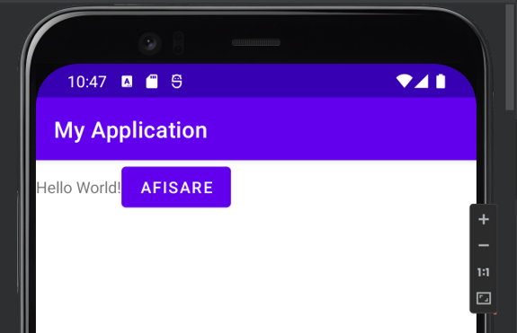
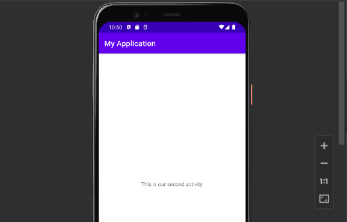

# Navigare între activități Android

## 🇷🇴 Română

### 1. Descriere

**Navigare între activități Android** este o aplicație mobilă, realizată în Android Studio, folosind limbajul de programare Java și interfețe grafice definite în XML.

Aplicația prezintă două ecrane distincte. Pe primul ecran este afișat un mesaj și un buton cu textul „Afișare”. La apăsarea butonului, utilizatorul este direcționat către al doilea ecran, unde este afișat un mesaj informativ.

## 2. Funcționalități

- Afișarea unui mesaj pe ecranul principal.
- Interacțiunea cu utilizatorul prin intermediul unui buton.
- Deschiderea celei de-a doua activități folosind un `Intent` explicit.
- Afișarea unui mesaj pe al doilea ecran.
- Definirea interfețelor grafice în fișiere XML.
- Separarea logicii aplicației în două activități distincte.

## 3. Tehnologii utilizate

- **Java** – limbajul folosit pentru implementarea logicii aplicației.
- **Android SDK** – instrumentele necesare dezvoltării aplicațiilor Android.
- **XML** – definirea interfețelor grafice.
- **Android Studio** – mediul de dezvoltare.
- **AndroidX AppCompat** – biblioteca utilizată pentru activitățile compatibile cu Android.

## 4. Capturi de ecran

Capturile de ecran prezintă interfața aplicației și navigarea dintre cele două activități.

### Ecranul principal



Pe ecranul principal sunt afișate mesajul de întâmpinare și butonul „Afișare”.

### Al doilea ecran



După apăsarea butonului, aplicația deschide a doua activitate și afișează mesajul corespunzător.

## 5. Exemple de cod

### 5.1. Gestionarea evenimentului de apăsare a butonului

În clasa `MainActivity.java`, butonul este configurat pentru a deschide a doua activitate.

```java
butonulMeu.setOnClickListener(new View.OnClickListener() {
    @Override
    public void onClick(View v) {

        // Cream un Intent pentru deschiderea celei de-a doua activitati
        Intent intentulMeu = new Intent(
                MainActivity.this,
                SecondActivity.class
        );

        // Pornim a doua activitate
        startActivity(intentulMeu);
    }
});
```

**Explicație:**

- `setOnClickListener()` definește acțiunea executată la apăsarea butonului.
- `Intent` specifică activitatea care trebuie deschisă.
- `startActivity()` pornește activitatea `SecondActivity`.

### 5.2. Inițializarea celei de-a doua activități

În clasa `SecondActivity.java`, metoda `onCreate()` încarcă interfața grafică a celui de-al doilea ecran.

```java
@Override
protected void onCreate(Bundle savedInstanceState) {
    super.onCreate(savedInstanceState);

    // Incarcam interfata grafica a celei de-a doua activitati
    setContentView(R.layout.activity_second2);
}
```

**Explicație:**

Metoda `onCreate()` este apelată în timpul creării activității, iar `setContentView()` asociază activitatea cu fișierul XML care definește interfața sa.

### 5.3. Definirea butonului în XML

În fișierul `activity_main.xml`, butonul este definit astfel:

```xml
<Button
    android:id="@+id/button"
    android:layout_width="wrap_content"
    android:layout_height="wrap_content"
    android:text="Afișare" />
```

**Explicație:**

- `android:id` identifică butonul în cadrul interfeței.
- `layout_width` și `layout_height` definesc dimensiunile acestuia.
- `android:text` stabilește textul afișat pe buton.

## 6. Structura proiectului

```text
Navigare-Intre-Activitati-Android/
│
├── README.md
├── build.gradle
├── gradle.properties
├── gradlew
├── gradlew.bat
├── settings.gradle
│
├── Images/
│   ├── ecran-principal.png
│   └── al-doilea-ecran.png
│
├── gradle/
│   └── wrapper/
│       ├── gradle-wrapper.jar
│       └── gradle-wrapper.properties
│
└── app/
    │
    ├── build.gradle
    ├── proguard-rules.pro
    │
    └── src/
        └── main/
            │
            ├── AndroidManifest.xml
            │
            ├── java/
            │   └── com/
            │       └── example/
            │           └── myapplication/
            │               ├── MainActivity.java
            │               └── SecondActivity.java
            │
            └── res/
                │
                ├── drawable/
                │   └── ic_launcher_background.xml
                │
                ├── drawable-v24/
                │   └── ic_launcher_foreground.xml
                │
                ├── layout/
                │   ├── activity_main.xml
                │   └── activity_second2.xml
                │
                ├── mipmap-anydpi-v26/
                │   ├── ic_launcher.xml
                │   └── ic_launcher_round.xml
                │
                ├── mipmap-hdpi/
                │   ├── ic_launcher.webp
                │   └── ic_launcher_round.webp
                │
                ├── mipmap-mdpi/
                │   ├── ic_launcher.webp
                │   └── ic_launcher_round.webp
                │
                ├── mipmap-xhdpi/
                │   ├── ic_launcher.webp
                │   └── ic_launcher_round.webp
                │
                ├── mipmap-xxhdpi/
                │   ├── ic_launcher.webp
                │   └── ic_launcher_round.webp
                │
                ├── mipmap-xxxhdpi/
                │   ├── ic_launcher.webp
                │   └── ic_launcher_round.webp
                │
                ├── values/
                │   ├── colors.xml
                │   ├── strings.xml
                │   └── themes.xml
                │
                └── values-night/
                    └── themes.xml
```

## 7. Instalare și rulare

### Cerințe preliminare

- Android Studio instalat.
- Android SDK configurat.
- Un emulator Android sau un dispozitiv Android compatibil.

### Pași pentru instalare

1. Clonează repository-ul:

   ```bash
   git clone https://github.com/IonutD3/Navigare-Intre-Activitati-Android.git
   ```

2. Deschide proiectul în Android Studio.
3. Așteaptă finalizarea sincronizării Gradle.
4. Pornește un emulator Android sau conectează un dispozitiv compatibil.
5. Apasă butonul **Run** din Android Studio pentru a compila și executa aplicația.

## 8. Obiective de învățare

Prin realizarea acestui proiect sunt exersate următoarele concepte:

- Organizarea unei aplicații Android.
- Crearea și configurarea activităților.
- Definirea interfețelor grafice cu XML.
- Identificarea componentelor folosind `findViewById()`.
- Gestionarea evenimentelor de apăsare a butoanelor.
- Navigarea între activități folosind `Intent`.
- Utilizarea metodelor `onCreate()` și `startActivity()`.

---

# 🇬🇧 English

## 1. Description

**Android Activity Navigation** is an mobile application developed in Android Studio using Java and XML-based user interfaces.

The application contains two separate screens. The first screen displays a message and a button labeled "Afișare" (Display). When the user presses the button, the application navigates to the second screen, where an informational message is displayed.

## 2. Features

- Displays a message on the main screen.
- Provides user interaction through a button.
- Opens the second activity using an explicit `Intent`.
- Displays a message on the second screen.
- Defines user interfaces in XML layout files.
- Separates application logic into two distinct activities.

## 3. Technologies Used

- **Java** – programming language used to implement the application logic.
- **Android SDK** – tools required for Android application development.
- **XML** – used to define user interfaces.
- **Android Studio** – integrated development environment.
- **AndroidX AppCompat** – library used for Android-compatible activities.

## 4. Screenshots

The screenshots demonstrate the application's user interface and navigation between the two activities.

### Main Screen


The main screen displays a welcome message and the "Afișare" (Display) button.

### Second Screen


After the button is pressed, the application opens the second activity and displays the corresponding message.

## 5. Code Examples

### 5.1. Handling the Button Click Event

In `MainActivity.java`, the button is configured to open the second activity.

```java
butonulMeu.setOnClickListener(new View.OnClickListener() {
    @Override
    public void onClick(View v) {

        // Create an Intent to open the second activity
        Intent intentulMeu = new Intent(
                MainActivity.this,
                SecondActivity.class
        );

        // Start the second activity
        startActivity(intentulMeu);
    }
});
```

**Explanation:**

- `setOnClickListener()` defines the action performed when the button is pressed.
- `Intent` specifies which activity should be opened.
- `startActivity()` launches `SecondActivity`.

### 5.2. Initializing the Second Activity

In `SecondActivity.java`, the `onCreate()` method loads the user interface for the second screen.

```java
@Override
protected void onCreate(Bundle savedInstanceState) {
    super.onCreate(savedInstanceState);

    // Load the user interface of the second activity
    setContentView(R.layout.activity_second2);
}
```

**Explanation:**

The `onCreate()` method is called during activity creation, while `setContentView()` associates the activity with the XML file that defines its user interface.

### 5.3. Defining the Button in XML

In `activity_main.xml`, the button is defined as follows:

```xml
<Button
    android:id="@+id/button"
    android:layout_width="wrap_content"
    android:layout_height="wrap_content"
    android:text="Afișare" />
```

**Explanation:**

- `android:id` identifies the button within the user interface.
- `layout_width` and `layout_height` define its dimensions.
- `android:text` specifies the text displayed on the button.

## 6. Project Structure

```text
Navigare-Intre-Activitati-Android/
│
├── README.md
├── build.gradle
├── gradle.properties
├── gradlew
├── gradlew.bat
├── settings.gradle
│
├── Images/
│   ├── ecran-principal.png
│   └── al-doilea-ecran.png
│
├── gradle/
│   └── wrapper/
│       ├── gradle-wrapper.jar
│       └── gradle-wrapper.properties
│
└── app/
    │
    ├── build.gradle
    ├── proguard-rules.pro
    │
    └── src/
        └── main/
            │
            ├── AndroidManifest.xml
            │
            ├── java/
            │   └── com/
            │       └── example/
            │           └── myapplication/
            │               ├── MainActivity.java
            │               └── SecondActivity.java
            │
            └── res/
                │
                ├── drawable/
                │   └── ic_launcher_background.xml
                │
                ├── drawable-v24/
                │   └── ic_launcher_foreground.xml
                │
                ├── layout/
                │   ├── activity_main.xml
                │   └── activity_second2.xml
                │
                ├── mipmap-anydpi-v26/
                │   ├── ic_launcher.xml
                │   └── ic_launcher_round.xml
                │
                ├── mipmap-hdpi/
                │   ├── ic_launcher.webp
                │   └── ic_launcher_round.webp
                │
                ├── mipmap-mdpi/
                │   ├── ic_launcher.webp
                │   └── ic_launcher_round.webp
                │
                ├── mipmap-xhdpi/
                │   ├── ic_launcher.webp
                │   └── ic_launcher_round.webp
                │
                ├── mipmap-xxhdpi/
                │   ├── ic_launcher.webp
                │   └── ic_launcher_round.webp
                │
                ├── mipmap-xxxhdpi/
                │   ├── ic_launcher.webp
                │   └── ic_launcher_round.webp
                │
                ├── values/
                │   ├── colors.xml
                │   ├── strings.xml
                │   └── themes.xml
                │
                └── values-night/
                    └── themes.xml
```

## 7. Installation and Setup

### Prerequisites

- Android Studio installed.
- Android SDK configured.
- An Android emulator or compatible Android device.

### Installation Steps

1. Clone the repository:

   ```bash
   git clone https://github.com/IonutD3/Navigare-Intre-Activitati-Android.git
   ```

2. Open the project in Android Studio.
3. Wait for Gradle synchronization to complete.
4. Start an Android emulator or connect a compatible device.
5. Click **Run** in Android Studio to build and launch the application.

## 8. Learning Objectives

This project provides practice with the following concepts:

- Structuring an Android application.
- Creating and configuring activities.
- Defining user interfaces using XML.
- Accessing UI components with `findViewById()`.
- Handling button click events.
- Navigating between activities using `Intent`.
- Using the `onCreate()` and `startActivity()` methods.

---

## 👤 Autor / Author

**IonutD**
